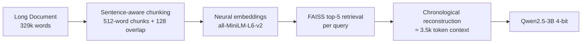

# DolphinMind
**Efficient long-context processing for small language models using semantic retrieval**

**DolphinMind** lets 1–7B models retrieve and reason over long documents by sending only the most relevant chunks to the model. On a needle-in-a-haystack benchmark it matches a native 64k context window while using ~88% fewer tokens.
## Key Results (Needle-in-a-Haystack Benchmark)
Classic “lost-in-the-middle” test with a single factual needle buried at 10%, 50%, or 90% depth in documents of 10k or 40k words.

| Method                  | Context Window | Accuracy | Tokens/Query | Notes                                    |
|-------------------------|----------------|----------|--------------|------------------------------------------|
| **DolphinMind (semantic)** | ≤3.5k budget | **60.4%** | **3,500**    | **Best overall**                         |
| SmolLM3 (native)        | 64k            | 58.3%    | 28,220       | 8× more tokens, still slightly worse     |
| Truncated               | 4k             | 16.7%    | 4,000        | Classic baseline                         |
| SmolLM3 (native)        | 4k             | 10.4%    | 4,080        | Collapses completely                     |

**Statistical significance** (DolphinMind vs others, two-sample t-test):  
- vs Truncated (4k): **p < 0.0001**, Cohen’s d = 0.996 (very large effect)  
- vs SmolLM3 4k: **p < 0.0001**  
- vs SmolLM3 64k: **p = 0.837** (statistically indistinguishable but with 88% token savings!)

**Key observations from heatmaps & curves**  
- Truncated & SmolLM3 4k: **total collapse** beyond the first ~10% of the document  
- SmolLM3 64k: strong at extremes, **severe middle dip** (classic lost-in-the-middle)  
- **DolphinMind**: only method that stays robust in the middle (50% depth → 93.8% accuracy)

## How DolphinMind Works (4-stage pipeline)



Peak memory usage: ~5.8 GB (model + embeddings + FAISS index)

## Quick start

> Requires a CUDA GPU (models load in 4-bit via `bitsandbytes`). Google Colab's free T4 works.

```bash
git clone https://github.com/aad-h/Dolphin_Mind.git
cd Dolphin_Mind
pip install -r requirements.txt

python run_benchmark.py --quick        # smoke test: 2 needles, 1 depth
python run_benchmark.py                # full benchmark -> results/needle_results.csv
```

Use the pipeline on your own document:

```python
from dolphinmind import SemanticRetriever
from dolphinmind.models import load_qwen, generate

model, tok = load_qwen()
context = SemanticRetriever().build_context(open("book.txt").read(), "Who killed the count?")
answer, n_tokens = generate(model, tok, f"Context:\n{context}\n\nQuestion: Who killed the count?\n\nAnswer:")
print(answer)
```

### Agent with an API model (no GPU)

`OpenAICompatLLM` drives the DolphinAgent ReAct loop with any OpenAI-compatible
`/chat/completions` endpoint (OpenAI, OpenRouter, Groq, vLLM, Ollama, llama.cpp...).
The key is read only from the environment:

```bash
export DOLPHIN_API_KEY=...                         # optional for local servers
export DOLPHIN_BASE_URL=https://api.openai.com/v1  # default
```

```python
from dolphinmind.agent import Document, OpenAICompatLLM, ReActAgent, Toolbox

llm = OpenAICompatLLM(model="gpt-4o-mini")
result = ReActAgent(llm, Toolbox(Document(open("book.txt").read()))).run("Who killed the count?")
print(result.answer, result.citations, llm.usage.total_tokens)
```

Transient errors (timeouts, 429, 5xx) are retried with exponential backoff and
`Retry-After`; token usage accumulates in `llm.usage`.

### Multi-agent: planner → workers → verifier

`MultiAgent` splits a question into ordered sub-questions, researches each with a
ReAct worker (later workers see earlier verified findings, so multi-hop chains can
follow a bridge entity), checks every finding against the chunks it cites, and
combines the verified findings into a final answer:

```python
from dolphinmind.agent import Document, MultiAgent, OpenAICompatLLM, Toolbox

agent = MultiAgent(OpenAICompatLLM(model="gpt-4o-mini"), Toolbox(Document(open("book.txt").read())))
res = agent.run("In which town was the chief archivist of Thisgate born?")
print(res.plan)                       # ['Who is the chief archivist of Thisgate?', 'Where was that person born?']
for f in res.findings:                # answer, citations, verified / flagged, attempts
    print(f.question, "->", f.answer, f.citations, "verified" if f.verified else "FLAGGED")
print(res.answer, res.citations)
```

| Stage | Behaviour |
|-------|-----------|
| planner | ≤ `max_sub_questions` (default 4) ordered sub-questions; a bad plan falls back to the question itself |
| workers | one `ReActAgent` per sub-question over a shared toolbox, `max_steps` tool calls each |
| verifier | `LLMVerifier` (default) asks the model whether the cited chunks state the answer; `LexicalVerifier` is a model-free token check. Uncited answers fail without a model call; an unsupported finding is retried `max_retries` times (default 1) with the verifier's reason, then replaced by `"not found"` and flagged |
| synthesis | combines findings (and does any arithmetic); may only cite chunks behind verified findings. Skipped for a single sub-question |

Workers currently run one after another. `run_agent_eval.py --systems react,multi`
compares it with the single agent.

### Command line

```bash
python -m dolphinmind.agent "Who killed the count?" --doc book.txt --trace
```

Prints the answer, each cited chunk and (with `--trace`) every thought, tool call
and observation, plus token usage for API backends.

| Flag | Meaning |
|------|---------|
| `--backend openai\|hf\|scripted` | API endpoint (default, key from `DOLPHIN_API_KEY`), local 4-bit Qwen (GPU), or canned replies |
| `--model`, `--base-url` | model name / OpenAI-compatible endpoint |
| `--script replies.json` | scripted backend: JSON list of model replies, for offline demos |
| `--semantic` | enable the `search_doc` tool (loads `all-MiniLM-L6-v2`); otherwise `grep` + `read_section` |
| `--max-steps`, `--chunk-size`, `--overlap` | tool budget and chunking |
| `--json` | machine-readable result (answer, citations with text, steps, usage) |

`--doc -` reads the document from stdin. Exit codes: 0 ok, 1 backend error, 2 bad usage.

### Evaluation datasets

`dolphinmind.eval` defines the benchmark format (one JSON object per line) and a
synthetic generator that plants invented facts into any long text at random
sentence boundaries, so answers can only come from the document:

```json
{"id": "moby-0001", "question": "In which town was the chief archivist of Thisgate born?",
 "answer": "Tuholm", "type": "multi_hop",
 "evidence": ["The chief archivist of Thisgate is Daendis Draemmork.", "Daendis Draemmork was born in Tuholm."],
 "doc_id": "moby", "metadata": {"bridge": "Daendis Draemmork", "depths": [0.2273, 0.048]}}
```

| Type | What it tests |
|------|---------------|
| `single_hop` | one planted sentence answers the question |
| `multi_hop` | two sentences linked by a bridge entity, planted independently |
| `numeric` | sum or difference of two planted quantities |
| `unanswerable` | the entity is mentioned but the fact never is; gold answer `"not found"` |

```bash
python -m dolphinmind.eval moby.txt pride.txt --out data/ -n 100   # data/moby.txt + data/moby.jsonl, ...
python -m dolphinmind.eval --haystack 20000 --out data/ --types single_hop,numeric --seed 1
```

Question types are balanced round-robin, generation is deterministic per `--seed`,
and every evidence string is checked to appear verbatim in the written document.
Load a dataset with `dolphinmind.eval.load_jsonl` (validates every line).

### Metrics

`dolphinmind.eval.metrics` scores each (system, question) pair and aggregates
with percentile-bootstrap 95% confidence intervals:

| Metric | Definition |
|--------|------------|
| `exact` | normalized match (case, punctuation, articles; `1,200.0` = `1200`) |
| `fuzzy` | gold appears as a whole-token span, or token F1 ≥ 0.8; numeric answers must state exactly one number, equal to gold |
| `f1` | SQuAD-style token F1 |
| `evidence_recall` | citation faithfulness: share of gold evidence found in the chunks the agent cited |
| `citation_precision` | share of cited chunks that contain any gold evidence |
| `tool_calls`, `total_tokens`, `latency_s`, `cost_usd` | cost per question |

Unanswerable questions count as correct only when the system abstains
(`"not found"`, `"the document does not say"`, ...); abstaining on an answerable
question is always wrong.

```python
from dolphinmind.eval import format_summary, load_jsonl, score_agent_result, summarize

scores = [score_agent_result(item, agent.run(item.question), doc.chunks) for item in items]
print(format_summary(summarize(scores)))   # | group | n | exact | fuzzy | ... with [lo, hi] CIs
```

### Comparing systems

`run_agent_eval.py` runs four systems (plus the opt-in `multi`) on a JSONL benchmark with the same chat
backend and the same context budget, then writes a per-question CSV and a markdown
summary (mean [95% bootstrap CI] per system, plus accuracy per question type):

| System | What the model sees |
|--------|---------------------|
| `truncation` | the first `top_k × chunk_size` words of the document |
| `rag` | plain RAG: fixed word windows (no overlap, sentence-blind), top-k by similarity, best first |
| `dolphinmind` | sentence-aware overlapping chunks, top-k, reassembled in document order |
| `react` | the DolphinAgent tool loop (`search_doc`, `grep`, `read_section`, `calculator`) with citations |
| `multi` | opt-in: planner → ReAct workers → verifier → synthesis (`MultiAgent`); several LLM calls per question |

```bash
python -m dolphinmind.eval --haystack 20000 --out data/ -n 40
python run_agent_eval.py data/haystack20000.jsonl --model gpt-4o-mini --prices 0.15,0.60
# -> results/agent_eval.csv (system x question) and results/agent_eval.md (summary table)
```

Each item's document is read from `<dataset dir>/<doc_id>.txt` (what the generator
writes) or `--doc book.txt`. Useful flags: `--systems react,dolphinmind`,
`--types multi_hop`, `--limit 20`, `--top-k`, `--chunk-size`, `--max-steps`,
`--embedder hashing` (offline bag-of-words instead of MiniLM). For the single-pass
systems `evidence_recall` is retrieval recall (did the evidence reach the model?).
Tokens come from the API's reported usage, or are estimated at ~4 chars/token
(flagged in the summary) for local models; backend errors count as wrong answers.

## Project structure

```
dolphinmind/
  retrieval.py     # sentence-aware chunking + FAISS SemanticRetriever
  models.py        # Qwen2.5-3B / SmolLM3-3B (YaRN) loading and generation
  evaluation.py    # needles, haystack builder, scoring, Cohen's d
  agent/           # DolphinAgent: LLM backends, tools, ReAct loop with citations,
                   # planner/worker/verifier multi-agent, CLI
  eval/            # benchmark JSONL schema, synthetic question generator, metrics + bootstrap CIs,
                   # system comparison runner
run_benchmark.py   # reproduces the results table
run_agent_eval.py  # truncation vs plain RAG vs DolphinMind vs ReAct agent -> CSV + summary
tests/             # GPU-free unit tests (pytest)
notebooks/
  01_load_model_and_profile.ipynb
  02_baseline_comparison.ipynb    # truncation, naive chunking, DolphinMind
  03_rlm_and_more_methods.ipynb   # RLM tools, map-reduce, hierarchical
  04_final_evaluation.ipynb
  05_benchmark.ipynb              # full needle-in-a-haystack evaluation
  rlm_core.ipynb                  # recursive LM tool loop
  DolphinMind_demo.ipynb          # Gradio demo
```

## Development

```bash
pip install -r requirements-dev.txt
pytest
```

> **Note on token counts:** the table above comes from `05_benchmark.ipynb`, which logged a fixed 3,500 / 4,000 tokens for DolphinMind / Truncated rather than measuring them. `run_benchmark.py` records the actual prompt length per query.

## License

MIT, see [LICENSE](LICENSE).
