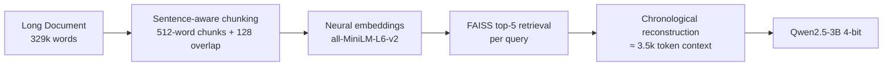

# DolphinMind
**Efficient long-context processing for small language models using semantic retrieval**

**DolphinMind** lets 1–7B models retrieve and reason over long documents by sending only the most relevant chunks to the model. On a needle-in-a-haystack benchmark it matches a native 64k context window while using ~88% fewer tokens.
## Key Results (Needle-in-a-Haystack Benchmark)
Classic “lost-in-the-middle” test with a single factual needle buried at 10%, 50%, or 90% depth in documents of 10k or 40k words.

| Method                  | Context Window | Accuracy | Tokens/Query | Notes                                    |
|-------------------------|----------------|----------|--------------|------------------------------------------|
| **DolphinMind (semantic)** | ≤3.5k budget | **60.4%** | **3,500**    | **Best overall**                         |
| SmolLM3 (native)        | 64k            | 58.3%    | 28,220       | 8× more tokens, still slightly worse     |
| Truncated               | 4k             | 16.7%    | 4,000        | Classic baseline                         |
| SmolLM3 (native)        | 4k             | 10.4%    | 4,080        | Collapses completely                     |

**Statistical significance** (DolphinMind vs others, two-sample t-test):  
- vs Truncated (4k): **p < 0.0001**, Cohen’s d = 0.996 (very large effect)  
- vs SmolLM3 4k: **p < 0.0001**  
- vs SmolLM3 64k: **p = 0.837** (statistically indistinguishable but with 88% token savings!)

**Key observations from heatmaps & curves**  
- Truncated & SmolLM3 4k: **total collapse** beyond the first ~10% of the document  
- SmolLM3 64k: strong at extremes, **severe middle dip** (classic lost-in-the-middle)  
- **DolphinMind**: only method that stays robust in the middle (50% depth → 93.8% accuracy)

## How DolphinMind Works (4-stage pipeline)



Peak memory usage: ~5.8 GB (model + embeddings + FAISS index)

## Quick start

> Requires a CUDA GPU (models load in 4-bit via `bitsandbytes`). Google Colab's free T4 works.

```bash
git clone https://github.com/aad-h/Dolphin_Mind.git
cd Dolphin_Mind
pip install -r requirements.txt

python run_benchmark.py --quick        # smoke test: 2 needles, 1 depth
python run_benchmark.py                # full benchmark -> results/needle_results.csv
```

Use the pipeline on your own document:

```python
from dolphinmind import SemanticRetriever
from dolphinmind.models import load_qwen, generate

model, tok = load_qwen()
context = SemanticRetriever().build_context(open("book.txt").read(), "Who killed the count?")
answer, n_tokens = generate(model, tok, f"Context:\n{context}\n\nQuestion: Who killed the count?\n\nAnswer:")
print(answer)
```

## Project structure

```
dolphinmind/
  retrieval.py     # sentence-aware chunking + FAISS SemanticRetriever
  models.py        # Qwen2.5-3B / SmolLM3-3B (YaRN) loading and generation
  evaluation.py    # needles, haystack builder, scoring, Cohen's d
run_benchmark.py   # reproduces the results table
tests/             # GPU-free unit tests (pytest)
notebooks/
  01_load_model_and_profile.ipynb
  02_baseline_comparison.ipynb    # truncation, naive chunking, DolphinMind
  03_rlm_and_more_methods.ipynb   # RLM tools, map-reduce, hierarchical
  04_final_evaluation.ipynb
  05_benchmark.ipynb              # full needle-in-a-haystack evaluation
  rlm_core.ipynb                  # recursive LM tool loop
  DolphinMind_demo.ipynb          # Gradio demo
```

## Development

```bash
pip install -r requirements-dev.txt
pytest
```

> **Note on token counts:** the table above comes from `05_benchmark.ipynb`, which logged a fixed 3,500 / 4,000 tokens for DolphinMind / Truncated rather than measuring them. `run_benchmark.py` records the actual prompt length per query.

## License

MIT, see [LICENSE](LICENSE).
